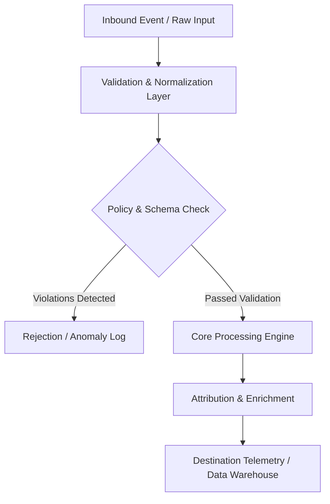

# Filtering Blueprint

## Architecture Specification: Server-Side GTM Cost Optimizer & Noise Event Pruner
This document defines the technical architecture and event flow for **Server-Side GTM Cost Optimizer & Noise Event Pruner** within the **reporting** domain.

### Operational Context
Create an open-source server-side GTM cost optimization toolkit: 1) Architecture guide detailing client-side event filtering triggers (blocking scroll, timer, and visibility events from sending sGTM requests), 2) Ready-to-import Web GTM transformation rules, 3) Python cloud billing cost estimator (`estimate_sgtm_cost.py`), 4) Step-by-step GCP Cloud Run auto-scaling and concurrency tuning instructions.

---

## System Architecture & Data Flow

## Functional Components

### 1. Ingestion & Normalization Layer
- Captures raw telemetry, webhooks, or file exports.
- Strips whitespace, normalizes regional casing, and sanitizes phone numbers and email strings into E.164 and SHA-256 formats.

### 2. Processing & Business Logic Rules
- Applies deterministic rule engines or statistical models without external black-box dependencies.
- Handles missing or delayed event attributes using bounded lookback windows.

### 3. Output Delivery & Error Handling
- Returns structured JSON payloads with machine-readable error codes and status telemetry.
- Employs exponential backoff retry logic (3 attempts: 1s, 5s, 15s) for downstream webhook delivery.

---
*Operational standard maintained by @mahmoudabdelnaby1.*
